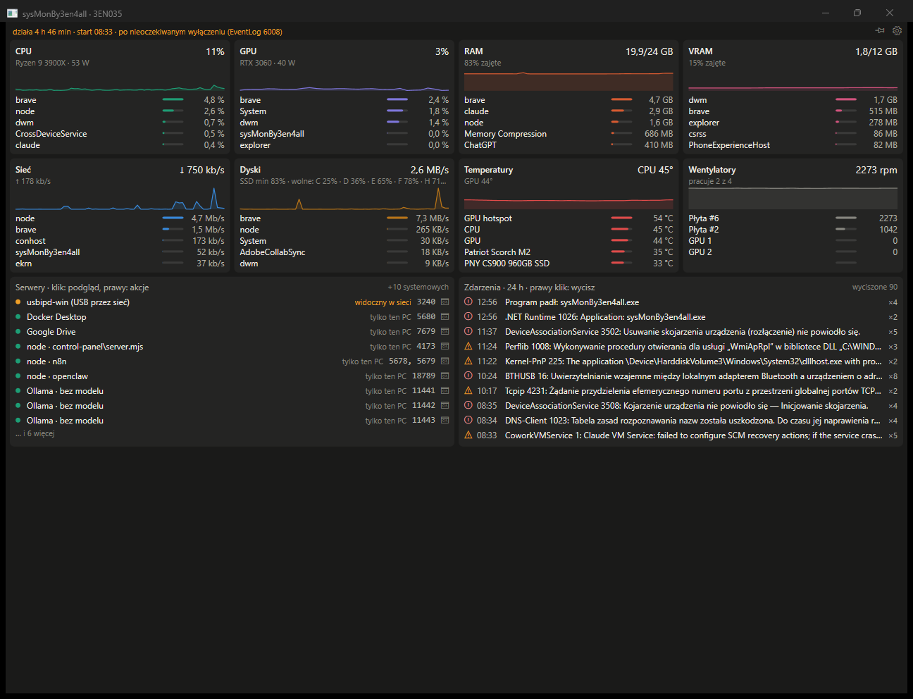

# sysMonBy3en4all

Lightweight Windows resource and server monitor (.NET 10, WinForms), ~220 MB RAM, ~0.3% CPU.



## Features
- CPU per physical core, process table (PID, path, CPU, RAM, sorting)
- GPU, RAM, disks, network (LibreHardwareMonitor, PDH)
- Local servers panel (detected from command lines; Ollama log view)
- Windows events panel with Polish descriptions
- Threshold alerts with hysteresis: CPU/GPU temperature, RAM, free disk space, SSD/NVMe health
- Uptime and last boot reason, tray icon, autostart, single instance

## Build
```
dotnet build -c Release
```
Requires Windows and .NET 10 SDK. Sensor access needs administrator rights.

Author: Jacek Grodnicki (3en4all)
